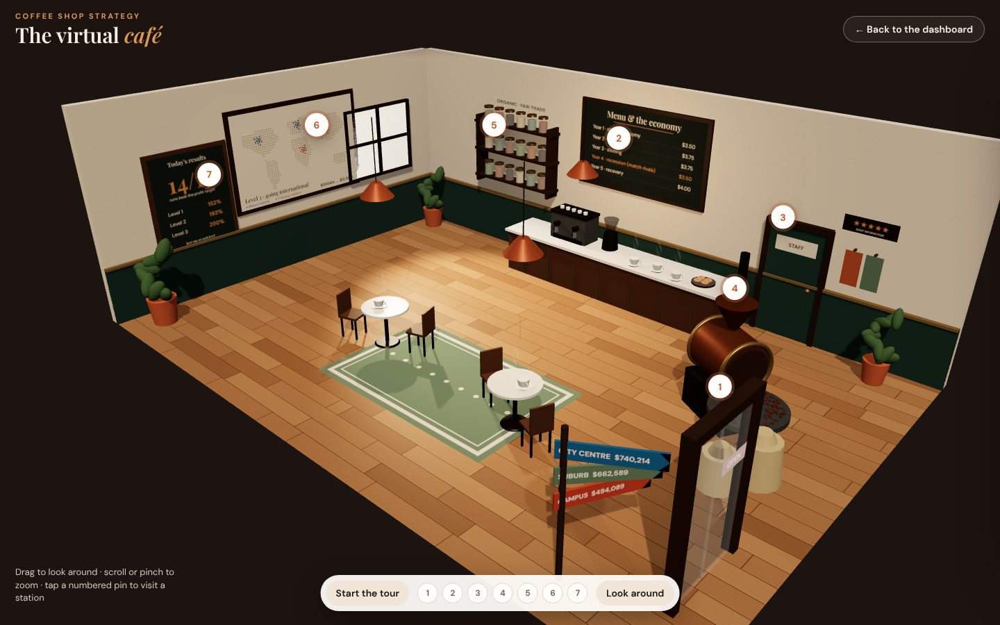

  

  
  

<h3 align="center">Fifteen runs of a coffee business, turned into a café you can walk through.</h3>

---

## ☕ How it works

Every corner of the café holds one finding from my Coffee Shop Inc. simulation runs (Sim Institute / Harvard Business Impact, October–November 2026). Tap a numbered pin, or press **Start the tour**, and the camera walks you there.

| # | Station | The finding |
|---|---|---|
| 1 | Front door | Location mattered most: City Centre $740,214 vs Campus $494,089 (Level 1, five-year profit) |
| 2 | Menu board | Match rivals in a recession, charge more in the recovery |
| 3 | Staff room | Pay a little more and keep training |
| 4 | Roastery | Roast only where customers notice the taste |
| 5 | Bean shelf | Certified beans pay when the label is trusted |
| 6 | World map | Enter growing markets early: Level 3 rose from $10.64m to $12.50m |
| 7 | Results board | 14 of 15 runs beat the target |

Drag to look around, scroll or pinch to zoom, and use the arrow keys to move between stations.

## 🧪 Method, briefly

- Every figure comes from the game's own result screens. Nothing is estimated.
- Later runs were paired with earlier ones, so a profit difference can be traced to the decision that changed. The location comparisons also differ slightly in pay, training or promotion, so they are descriptive rather than perfectly clean.
- The game is a simplification. Read the findings as decision principles, not forecasts.

## 🗂️ Files

| File | Purpose |
|---|---|
| `index.html` | The whole café: one page, built with three.js (loaded from a CDN) |
| `cafe-preview.png` | README image |
| `LICENSE` | Intellectual property notice (all rights reserved) |

## ©️ Intellectual property

© 2026 Shabnam Mohammed Sameer (DewPoint Analytics). All rights reserved. You may view the site and link to it; please do not copy or republish the analysis, design or code. See [LICENSE](LICENSE).
